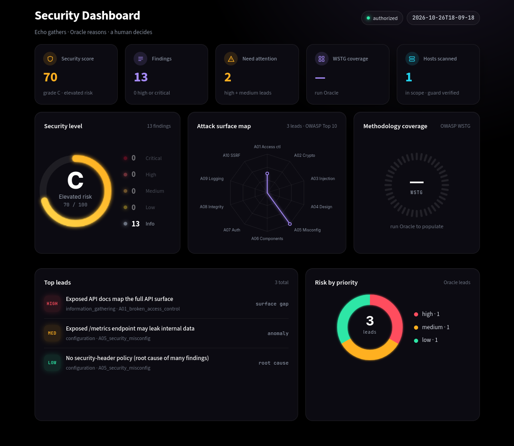

# Echo Oracle

An AI-assisted reconnaissance and triage toolkit for authorized security assessment.

**Echo gathers. Oracle reasons. A human decides.**

Echo wraps the standard open-source recon tools behind one command and uses AI to separate real findings from scanner noise. Oracle, its reasoning engine, reads a finished run and surfaces the non-obvious, in-scope leads a checklist scanner walks past. Every target is checked against a fail-closed scope guard before a single packet is sent, and nothing leaves the tool without a person reviewing it.

> **Authorized testing only.** Run Echo Oracle only against systems you own or have explicit written permission to test. See [Authorized testing only](#authorized-testing-only).



---

## Contents

- [Echo and Oracle](#echo-and-oracle)
- [Requirements](#requirements)
- [Install](#install)
- [Quick start](#quick-start)
- [Pipeline](#pipeline)
- [Command reference](#command-reference)
- [Reading the output](#reading-the-output)
- [Dashboard](#dashboard)
- [Project structure](#project-structure)
- [Running the tests](#running-the-tests)
- [Authorized testing only](#authorized-testing-only)
- [License](#license)

---

## Echo and Oracle

| | Echo | Oracle |
|---|---|---|
| Role | Data engine | Reasoning engine |
| Does | Checks scope, runs the scanners, triages findings, runs the detectors, writes the report | Reads a finished run, maps it to OWASP WSTG, correlates findings to root causes, ranks leads |
| Model | Claude (fast triage) | Claude (deep reasoning), optional second model for the cross-check |
| Output | `scope_decisions.json`, `findings.json`, `assets.json`, `triaged.json`, `detections.json`, `report.md` | `oracle_analysis.json`, `oracle_analysis.html` |

**Echo**

- **Scope guard.** A fail-closed allowlist with three verdicts, re-checked on every host discovered during a run.
- **Scanners.** subfinder, httpx and nuclei, with opt-in nmap for ports.
- **Detection registry.** whatweb, wafw00f, TLS and security-header checks; noisier tools stay opt-in.
- **AI triage.** Keeps what is real, suppresses what is not, and records a one-line reason for every decision.
- **Report.** Priority-ranked Markdown report with CVSS v3.1 severity banding.

**Oracle**

- **WSTG methodology.** Reasons across the OWASP testing categories and records which ones the evidence can and cannot assess.
- **Correlation.** Ties scattered findings to shared root causes instead of a flat list.
- **Ranked leads.** Each lead carries a reasoning chain, an OWASP class, a read-only next check and a step to test by hand.
- **Cross-check.** A second model from a different lab analyzes the same run independently. Disagreements are reported, not averaged away.
- **Blind reconciliation.** An optional reviewer pass merges both analyses and states why it settled each split.
- **Guided investigation.** `oracle hunt` proposes read-only follow-up fetches, waits for your approval on each one, and re-reasons over what comes back. Every fetch passes the scope guard.

Oracle is read-only by design. It proposes information-gathering checks and flags what a person should test by hand. It generates no payloads and never exploits.

---

## Requirements

**Python 3.11 or newer** (developed on 3.14).

**API keys**

- Anthropic (Claude): required.
- OpenAI: only needed for `oracle crosscheck`.

**System tools**

Echo calls these as external programs. Most ship with Kali Linux.

| Tool | Used by | When it runs |
|---|---|---|
| subfinder | `scan` | With `--domain` |
| httpx (ProjectDiscovery) | `scan` | Always |
| nuclei | `scan` | Always, unless `--no-nuclei` |
| nmap | `scan`, `assess` | Only with `--nmap`, `--nmap-ports` or `--nmap-all` |
| whatweb | `detect` | If installed |
| wafw00f | `detect` | If installed |
| testssl.sh | `detect` | If installed |
| nikto | `detect` | If installed |
| dnsrecon | `detect` | If installed |

`detect` runs every installed detection tool unless you pass `--tools`. Inside `assess`, detection runs whatweb, wafw00f and the built-in security-header check. Missing detection tools are skipped, not errors.

Install the ProjectDiscovery tools with Go, and put `~/go/bin` first on your `PATH`. Kali ships an unrelated Python package that is also called `httpx`, and the ordering makes sure the ProjectDiscovery binary wins:

```bash
go install -v github.com/projectdiscovery/subfinder/v2/cmd/subfinder@latest
go install -v github.com/projectdiscovery/httpx/cmd/httpx@latest
go install -v github.com/projectdiscovery/nuclei/v3/cmd/nuclei@latest
echo 'export PATH=$HOME/go/bin:$PATH' >> ~/.zshrc && source ~/.zshrc
nuclei -update-templates
```

Check that the right binaries are found:

```bash
which subfinder httpx nuclei
httpx -version
```

The version banner should say `projectdiscovery`.

---

## Install

```bash
git clone https://github.com/your-user/echo-oracle.git
cd echo-oracle
python -m venv .venv
source .venv/bin/activate
pip install -r requirements.txt
```

Add your API keys:

```bash
cp .env.example .env
# then edit .env
```

Define your scope:

```bash
cp scope.example.yaml scope.yaml
# then edit scope.yaml
```

`scope.yaml` holds allow and deny lists. An empty allow list blocks everything. Keep it out of version control; it describes what you are authorized to test.

---

## Quick start

Confirm a target is in scope. This sends nothing to the target.

```bash
python -m echov scope-check --target juice.lab.local
```

```
Scope guard: ALLOW juice.lab.local  matched allow rule "*.lab.local"
```


Run the full pipeline in one command:

```bash
python -m echov assess --target juice.lab.local
```

No API key yet? `--mock` swaps the AI steps for offline, rule-based reasoning, so you can try the whole pipeline at no cost:

```bash
python -m echov assess --target juice.lab.local --mock
```

Re-analyze a finished run with two models, then merge them with a blind reviewer:

```bash
python -m echov oracle crosscheck --reconcile
```

Open the dashboard:

```bash
python -m streamlit run dashboard/console.py
```

---

## Pipeline

`assess` runs scan, triage, detection and Oracle in that order, then writes the report. Each stage can also be run on its own. Every run writes to `data/runs/<run>/`, and each stage reads the previous stage's output from there, so re-running Oracle never re-scans. Commands that take `--run` default to the newest run.

| Order in `assess` | Stage | Command | Reads | Writes |
|---|---|---|---|---|
| | Scope guard | `scope-check` | `scope.yaml` | nothing (prints verdicts) |
| 1 | Scan | `scan` | `scope.yaml` | `scope_decisions.json`, `findings.json`, `assets.json` |
| 2 | Triage | `triage` | `findings.json` | `triaged.json` |
| 3 | Detect | `detect` | `assets.json` | `detections.json` |
| 4 | Oracle | `oracle analyze` | the full run folder | `oracle_analysis.json` |
| 5 | Report | `report` | `triaged.json` | `report.md` |
| | Oracle report | `oracle report` | `oracle_analysis.json` | `oracle_analysis.html` |

`assets.json` lists the live hosts with their status codes. `oracle_analysis.json` holds both the ranked leads and the WSTG coverage map. The scope guard is applied to every host the scan discovers, not only to the ones you pass in.

After the last stage, a person reads the report or the dashboard, runs the proposed checks by hand, and decides what, if anything, becomes a submission.

---

## Command reference

All commands run as `python -m echov <command>`. Every command takes `--help`.

Commands that take `--scope` default to `scope.yaml`. Commands that take `--run` default to the newest folder under `data/runs/`. `--context` is a sentence passed to the AI describing the engagement, so it can judge findings accordingly.

### scope-check

Checks hosts against the scope guard. Scans nothing.

| Option | Description |
|---|---|
| `--target TEXT` | A host to check. |
| `--file TEXT` | A file of hosts to check. |
| `--scope TEXT` | Scope file. Default `scope.yaml`. |

### scan

Runs the recon pipeline against in-scope targets only. Asks for confirmation before sending anything.

| Option | Description |
|---|---|
| `--domain TEXT` | Root domain for subfinder discovery. |
| `--target TEXT` | Seed a host directly. Repeatable. |
| `--no-nuclei` | Discovery only; skip the vulnerability scan. |
| `--tags TEXT` | Limit nuclei to these template tags. |
| `--rate-limit INTEGER` | Scan rate limit. Default 150. |
| `--nmap` | Opt-in port scan, top 100 ports. |
| `--nmap-ports` | Opt-in port scan, top 1000 ports. |
| `--nmap-all` | Opt-in port scan, all 65535 ports. Loud; confirm the program allows it. |
| `--yes` | Skip the confirmation prompt. |
| `--scope TEXT` | Scope file. |

### triage

Classifies a run's findings as real, false positive, or needs review.

| Option | Description |
|---|---|
| `--run TEXT` | Run folder. Default: newest. |
| `--context TEXT` | Engagement context. Default: known-vulnerable practice lab (OWASP Juice Shop). |
| `--model TEXT` | Override the triage model. |
| `--mock` | Offline rule-based triage. No API key, no cost. |

### detect

Runs read-only detection tools (technology, WAF, TLS, headers) on in-scope targets.

| Option | Description |
|---|---|
| `--target TEXT` | Host or URL to fingerprint. Repeatable. |
| `--tools TEXT` | Comma-separated list. Default: every installed tool. |
| `--scope TEXT` | Scope file. |

### report

Generates a human-readable Markdown report from a triaged run.

| Option | Description |
|---|---|
| `--run TEXT` | Run folder. Default: newest. |

### assess

One-shot pipeline: scan, triage, detection, Oracle, report.

| Option | Description |
|---|---|
| `--target TEXT` | Host to assess. Repeatable. |
| `--domain TEXT` | Root domain for subfinder discovery. |
| `--tags TEXT` | Nuclei template tags. Default `exposure,misconfig,tech`. |
| `--nmap` | Opt-in port scan. |
| `--detect / --no-detect` | Run the detection tools (whatweb, wafw00f, headers). |
| `--model TEXT` | Override the model. |
| `--mock` | Oracle uses free offline reasoning. |
| `--context TEXT` | Engagement context. Default: authorized assessment. |
| `--yes` | Skip confirmations. Lab use only. |
| `--scope TEXT` | Scope file. |

### oracle analyze

Reasons over a finished run and surfaces prioritized leads.

| Option | Description |
|---|---|
| `--run TEXT` | Run folder. Default: newest. |
| `--context TEXT` | Engagement context. Default: known-vulnerable practice lab (OWASP Juice Shop). |
| `--model TEXT` | Override Oracle's model. |
| `--mock` | Offline reasoning. No API key, no cost. |

### oracle crosscheck

Runs two models from different labs on the same run and flags where they agree and disagree.

| Option | Description |
|---|---|
| `--run TEXT` | Run folder. |
| `--context TEXT` | Engagement context. Default: authorized assessment. |
| `--sonnet-model TEXT` | Override the Claude model. |
| `--gpt-model TEXT` | Override the GPT model. |
| `--reconcile` | Add a blind reviewer pass that merges both analyses. |

### oracle fetch

Runs the read-only fetches Oracle proposed in its last analysis. Every fetch passes the scope guard first.

| Option | Description |
|---|---|
| `--run TEXT` | Run folder. |
| `--scope TEXT` | Scope file. |

### oracle hunt

A bounded, read-only investigation loop: Oracle proposes fetches, you approve each one, and it re-reasons over the results.

| Option | Description |
|---|---|
| `--run TEXT` | Run folder. |
| `--rounds INTEGER` | Maximum reasoning rounds. Default 6. |
| `--program TEXT` | Optional `program.md` with the program's scope rules, given to Oracle as context. |
| `--context TEXT` | Engagement context. |
| `--model TEXT` | Override the model. |
| `--scope TEXT` | Scope file. |

### oracle report

Renders the latest Oracle analysis as a styled HTML page.

| Option | Description |
|---|---|
| `--run TEXT` | Run folder. |

---

## Reading the output

Terminal, report and dashboard share one legend.

**Finding severity (CVSS v3.1)**

| Severity | Score |
|---|---|
| Critical | 9.0 – 10.0 |
| High | 7.0 – 8.9 |
| Medium | 4.0 – 6.9 |
| Low | 0.1 – 3.9 |
| Info | 0.0 |

**Lead priority (Oracle)**

Priority is Oracle's judgment of how worth investigating a lead is. It is a separate axis from CVSS: findings get a severity up to Critical, leads only ever get high, medium or low. Every lead carries a read-only next check and a step to test by hand.

**Scope verdicts**

| Verdict | Meaning |
|---|---|
| `ALLOW` | Matched an allow rule and no deny rule. Scanners may touch it. |
| `LEAD` | Discovered but not in the allow list. Logged for you to add to scope or ignore. Nothing is sent. |
| `DENY` | Matched a deny rule. Logged with the rule, never scanned. |

**Flags**

- **Needs human review.** Set by triage when a finding cannot be confirmed from the evidence alone. The report says *Verify manually*. Example: an exposed `/metrics` endpoint where the scan did not capture the page contents.
- **Priority split.** Set by `oracle crosscheck` when the two models give the same lead different priorities. With `--reconcile`, the reviewer picks one and states why.

**No findings is not an all-clear.** Oracle reports which WSTG categories the evidence could not assess. That list is the to-do list for the manual stage, and it is why the tool never reports a target as secure.

---

## Dashboard

A Streamlit console over the files in the run folder. There is no database and no second copy of the data: what the terminal printed is what the console shows.

```bash
python -m streamlit run dashboard/console.py
```


- **Top row.** Security score and grade, finding count, leads that need attention, WSTG coverage, and hosts scanned.
- **Middle row.** Severity breakdown, an attack-surface radar across the OWASP Top 10, and methodology coverage once Oracle has run.
- **Bottom row.** Oracle's top leads with class and category, and risk by priority.

---

## Project structure

```
echo-oracle/
├── echov/
│   ├── __main__.py        entry point for python -m echov
│   ├── cli.py             command definitions
│   ├── runner.py          stage orchestration for assess
│   ├── scope.py           scope guard
│   ├── severity.py        CVSS v3.1 banding
│   ├── models.py          shared data models
│   ├── scanners/          subfinder, httpx, nuclei, nmap
│   ├── tools/             detection registry: whatweb, wafw00f, headers,
│   │                      testssl, nikto, dnsrecon
│   ├── triage/            AI triage: client, prompts, schema
│   ├── report/            Markdown report rendering
│   └── oracle/            reasoning engine: analysis, cross-check,
│                          reconciliation, prompts, schemas, HTML report
├── dashboard/
│   └── console.py         Streamlit security console
├── tests/
│   └── test_scope.py      scope guard tests
├── docs/screenshots/
├── scope.example.yaml
├── .env.example
├── requirements.txt
├── requirements-dev.txt
└── LICENSE
```

---

## Running the tests

```bash
pip install -r requirements-dev.txt
pytest
```

---

## Authorized testing only

Echo Oracle is a reconnaissance and triage tool. Scanning systems without permission is illegal in most jurisdictions and against the rules of every bug bounty program.

- Run it only against systems you own, intentionally vulnerable lab targets (OWASP Juice Shop, DVWA, TryHackMe, Hack The Box), or targets explicitly in scope for a program you are enrolled in.
- Read the program's rules before the first scan. Some programs prohibit automated scanning, set rate limits, or exclude specific hosts; encode those in `scope.yaml`.
- The scope guard fails closed: a host with no matching allow rule is never scanned. It reduces mistakes; it does not replace your own judgment about what you are permitted to test.
- Oracle never exploits. Anything beyond information gathering is a deliberate step a person takes by hand, under the program's rules.
- Verify every finding yourself before reporting it.

---

## License

MIT. See [LICENSE](LICENSE).
